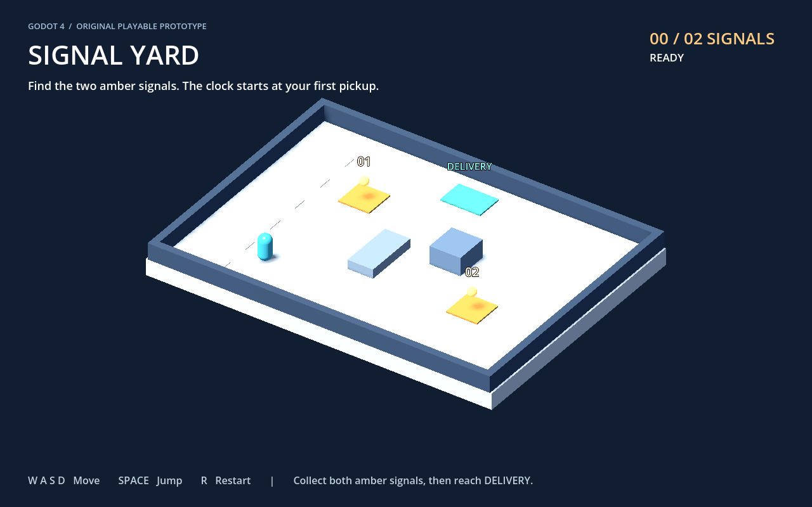

# Signal Yard

A small original Godot 4 3D prototype: collect two amber signals, then reach the green delivery pad before the timer expires.



## Try it

Open `project.godot` in Godot 4.7.2 and press **F6** with `main.tscn` open, or **F5** to run the project.

**WASD** moves relative to the camera. **Space** jumps. **R** restarts. The 30-second timer starts at the first pickup. Both signals are required to finish.

No plugins, external art, accounts, or downloads beyond Godot are needed. All meshes are built from primitives in the scene script.

## What is implemented

- `CharacterBody3D` movement, gravity, jumping and solid collisions.
- One-shot `Area3D` pickup signals with duplicate and unrelated-body guards.
- A `Timer`-driven delivery window and explicit success/timeout states.
- A bounded isometric arena, readable HUD and restart control.

## Reproduce the checks

From the project folder, with Godot on your PATH:

```sh
godot --headless --path . --script res://tests/integration.gd
godot --path . -- --capture
```

The first command runs the actual scene with engine physics and timers, writes `evidence/integration-results.json`, and exits nonzero if a check fails. The second renders the scene and saves `evidence/preview.png`; it needs a graphical session.

**Recorded result:** 10 checks passed, 0 failed on Windows with Godot 4.7.2. The checks cover gravity/landing, jumping, perimeter collision, an incomplete route, an unrelated body, a real pickup overlap, duplicate pickup rejection, successful delivery and expiry. See the [timestamped report](evidence/integration-results.json).

This is a self-directed capability sample, not a shipped game or a customer project. Automated checks use synthetic input. The preview is an actual engine render; browser, mobile and other operating systems have not been tested. This sample does not implement checkpoint persistence or respawning in someone else's platformer.

MIT licensed. No customer data or third-party game assets are included.
