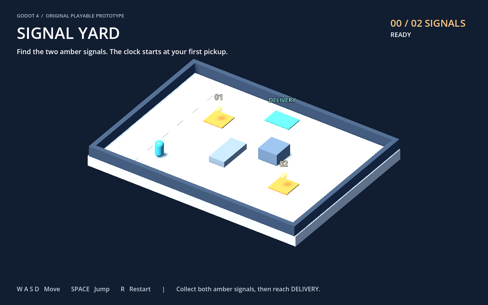

# 信号场

一个很小的 Godot 4 三维场景：先捡起两个琥珀色信号，再在倒计时结束前走到绿色交付台。



## 怎么玩

用 Godot 4.7.2 打开 `project.godot`。打开 `main.tscn` 后按 **F6**，或按 **F5** 运行项目。

**WASD** 按镜头方向移动，**空格** 跳跃，**R** 重开。第一次捡到信号后开始 30 秒倒计时。两个信号都要拿到才能完成。

除了 Godot 本身，不需要插件、外部素材、账号或额外下载。场景里的模型都是用基本几何体在脚本里搭的。

## 里面有什么

- `CharacterBody3D` 的移动、重力、跳跃和固体碰撞
- 一次性的 `Area3D` 拾取，会挡住重复捡取和无关物体
- 用 `Timer` 控制交付时限，以及完成 / 超时两种结果
- 有边界的等距场地、可读的界面，以及重开

## 复现检查

在项目目录下，确认 Godot 已加入 PATH：

```sh
godot --headless --path . --script res://tests/integration.gd
godot --path . -- --capture
```

第一条会真正跑场景（含引擎物理和计时器），写出 `evidence/integration-results.json`，有检查失败就非零退出。第二条会渲染场景并保存 `evidence/preview.png`，需要图形界面。

记录结果：在 Windows、Godot 4.7.2 上 10 项检查全部通过、0 项失败。覆盖重力落地、跳跃、边界碰撞、未完成路线、无关物体、真正捡到、拒绝重复捡取、成功交付和超时。检查用的是脚本模拟操作。见 [带时间戳的报告](evidence/integration-results.json)。

浏览器、手机和其他系统还没测过。这个示例没有存档点，也不能放到别的平台游戏里直接重生。

MIT 许可。

<details>
<summary>English</summary>

A small Godot 4 3D scene: collect two amber signals, then reach the green delivery pad before the timer expires.

Open `project.godot` in Godot 4.7.2. Press F6 with `main.tscn` open, or F5 to run the project. WASD moves relative to the camera, Space jumps, R restarts. The 30-second timer starts at the first pickup. Both signals are required to finish.

From the project folder:

```sh
godot --headless --path . --script res://tests/integration.gd
godot --path . -- --capture
```

Recorded result: 10 checks passed, 0 failed on Windows with Godot 4.7.2. See `evidence/integration-results.json`. The second command needs a graphical session to write `evidence/preview.png`.

</details>
